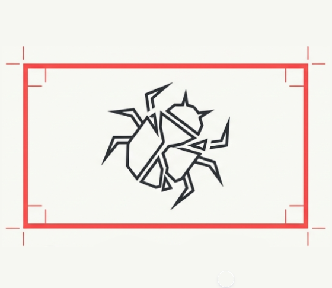
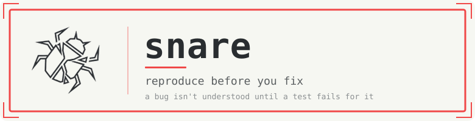

<div align="center">





<br>

[](https://github.com/myselfAbdullah007/snare/releases)
[](LICENSE)


**Turn a bug report or stack trace into _one failing test_ that reproduces it — before any fix.**



</div>

---

## The problem

Everyone knows you should write a failing test before fixing a bug. Almost nobody does — it's tedious, and "I can see the bug right there" wins. So the fix lands with no test, the next refactor quietly brings the bug back, and you debug it twice.

Worse: the tests people *do* rush out often fail for the **wrong reason** — a missing import, a bad fixture, a typo'd assertion. That test goes green the moment someone fixes something unrelated, and the real bug ships anyway.

## What `snare` does

Paste a stack trace or describe the bug. `snare`:

1. **Reads the evidence** and traces from the top frame down to the line that's actually wrong.
2. **Finds the lowest layer** that still shows the failure — a pure function beats an HTTP round-trip beats a full E2E flow.
3. **Writes ONE test** in your repo's existing framework, arranging the reported state and asserting the *correct* behavior — so it fails today.
4. **Runs it and proves it's red for the _reported_ reason** — same exception, same wrong value — not an import error or a typo.
5. **Stops.** It does not fix the bug. The red test is the deliverable; the fix must turn it green.

> **The whole game:** a test that fails for the wrong reason is worse than no test. `snare` verifies the failure matches the reported symptom before it hands anything over.

## Install

```
/plugin marketplace add myselfAbdullah007/snare
/plugin install snare
```

## Use

Paste a stack trace or describe the bug, then:

```
/snare
```

…or just say *"reproduce this"* / *"write a failing test for this"*. You get back:

```
Bug:      what's actually broken and where — file:line
Test:     path::testname
Red:      the assertion/exception that fires, quoted from the real run
Fix hint: the root cause, so the fix step knows where to go
```

…and then it stops.

## Examples

| Example | Bug | Reproduced at |
|---|---|---|
| [Order total underflow](examples/order-total-underflow.md) | Negative quantity drives a total below zero | Pure function |
| [Pagination off-by-one](examples/pagination-off-by-one.md) | Last row dropped from the final page | Query builder |

Each shows the input a dev pastes and the exact red test `snare` produces.

## What it deliberately won't do

- **Won't fix the bug.** Reproduce and fix are separate acts; the red test is the handoff.
- **Won't write a suite.** One test, the narrowest case that proves the bug.
- **Won't add a framework.** It uses whatever your repo already has.
- **Won't guess.** Can't reproduce from the given info? It names the exact missing fact instead of inventing a test.

## Why it's shaped this way

`snare` is a *triggered* skill, not a background mode — it fires when you call it and gets out of the way. No hooks, no persistent state, no dependencies. The skill is a single prompt file; everything else here is manifest, command, and docs.

## License

[MIT](LICENSE) © Abdullah Chaudhary
